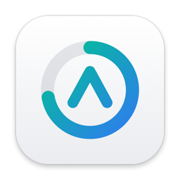
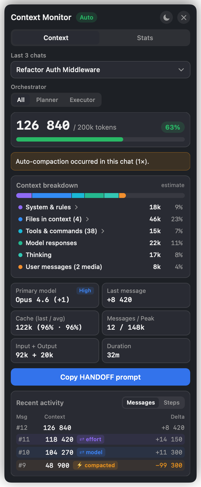
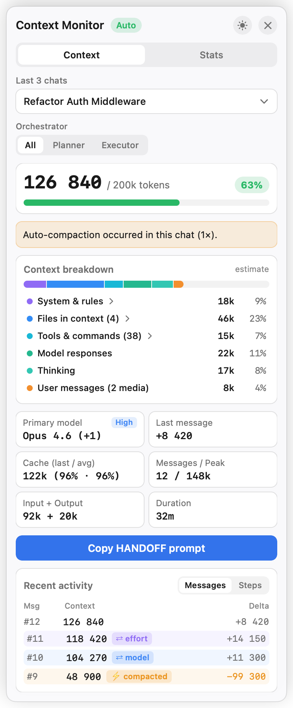
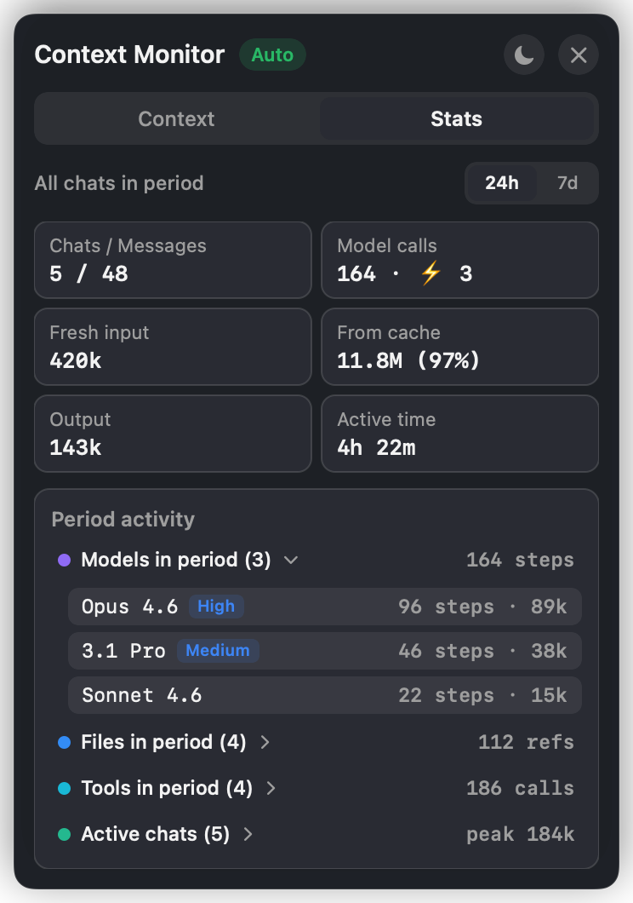
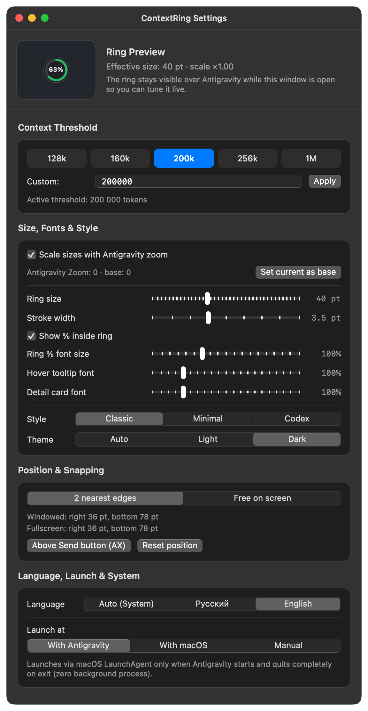
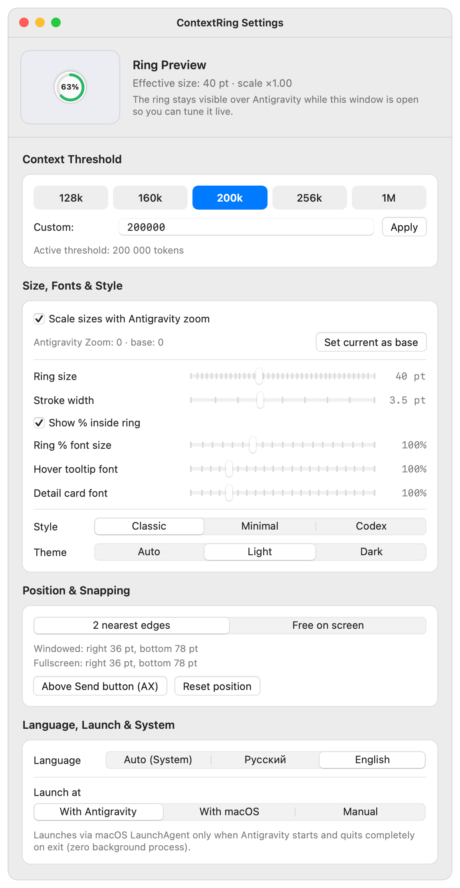

<div align="center">
  
  <h1>ContextRing for Antigravity 2.0</h1>
  <p>
    <strong>🇬🇧 English</strong> &nbsp;|&nbsp; <a href="README.ru.md">🇷🇺 Русский</a>
  </p>
  <p>
    <a href="https://github.com/vladsboev-web/ContextRing/releases"></a>
    <a href="https://github.com/vladsboev-web/ContextRing"></a>
    <a href="LICENSE"></a>
  </p>
</div>

Native macOS (Swift / AppKit / SwiftUI) floating context ring and menu bar monitor for **Google Antigravity 2.0** (`com.google.antigravity`).

> **Looking for a lightweight in-IDE plugin instead?**  
> If you don't need a macOS floating overlay or want cross-platform support (macOS / Linux / Windows) with a Sidecar panel + instant 0-token `/ctx` and `/чат` commands inside Antigravity, see **[chat_tokens](https://github.com/vladsboev-web/chat_tokens)**.

---

## Screenshots

### Context & Stats Popover

<table>
  <tr>
    <th align="center">Context Tab (Dark)</th>
    <th align="center">Context Tab (Light)</th>
    <th align="center">Stats Tab — 24h / 7d (Dark)</th>
  </tr>
  <tr>
    <td align="center"></td>
    <td align="center"></td>
    <td align="center"></td>
  </tr>
</table>

### Unified Settings Window

<table>
  <tr>
    <th align="center">Settings (Dark)</th>
    <th align="center">Settings (Light)</th>
  </tr>
  <tr>
    <td align="center"></td>
    <td align="center"></td>
  </tr>
</table>

---

## What's New in 1.1.0

- **Minimalist macOS App Icon** (`Resources/AppIcon.icns`) — frosted squircle with an emerald-to-blue context arc and Antigravity emblem inside.
- **Event-Driven Engine (0% Idle CPU)** — incremental `FileHandle.seek` tail reading + `DispatchSourceFileSystemObject` file watchers + `AXObserver` window tracking. Zero polling or background CPU when Antigravity is minimized or closed.
- **Orchestrator & Multi-Model Scope Switcher** — switch between `All | Orchestrator | Executor` (or `All | <Models>` in manual mode, or 2-level when both modes exist in the same chat). Updates the floating ring, menu bar `%`, hover tooltip, and Context tab simultaneously.
- **Redesigned Context Breakdown Table** — aligned 1-column breakdown with expandable subcategories and file/tool lists (*System & rules*, *Files in context*, *Tools & commands*, *Model responses*, *Thinking*, *User messages*), hiding 0-token rows.
- **Dedicated Stats Tab (`24h / 7d`)** — global analytics across all chats: 6-cell summary grid (*Chats / Messages*, *Model calls & compactions*, *Fresh input*, *From cache*, *Output*, *Active time*) plus expandable *Models*, *Files*, *Tools*, and *Active chats* with click-to-open.
- **Reasoning Effort Pill & History Badges** — displays formatted short model names (`Opus 4.6`, `3.1 Pro`, `4 Argon`) with an effort pill (`Low` / `Medium` / `High` / `XHigh`) and tracks `⚡ compacted`, `⇄ model`, and `⇄ effort` transitions in history.
- **Theme Sync & Quick Switch** — syncs automatically with Antigravity (`User/settings.json` + `app_storage.json`), plus a 1-click **Auto / Light / Dark** cycle button right in the popover header.
- **Full Bilingual UI (`System / Русский / English`)** — automatic detection from macOS language preferences with live switching in Settings and the Menu Bar.
- **Universal Binary & Standard Account Support** — builds `arm64 + x86_64` by default, pins `codesign` designated requirement to the certificate CN (keeping Accessibility permission across rebuilds), and supports macOS Standard (non-admin) accounts via native admin prompt or `--user` install into `~/Applications`.

---

## Features

- **Floating Context Ring**
  - Tracks active Antigravity 2.0 windows across desktops, Spaces, and macOS Fullscreen.
  - Three ring styles (**Classic**, **Minimal**, **Codex**) with **Auto / Light / Dark** appearance sync.
  - Links ring, tooltip, and popover scaling to Antigravity zoom level (`zoomLevel`), plus independent size, stroke, and font sliders.
  - **2-nearest-edge** per-window anchoring (separate anchors for Windowed and Fullscreen) or **Free on screen** absolute positioning.
  - Neutral `—` state when switching to a chat without token logs yet.

- **Hover Tooltip & Detail Popover**
  - **Context Tab**: threshold progress bar, compaction alerts, Context Breakdown table, 6-tile session summary (*Primary model + effort*, *Last message/step*, *Cache last/avg*, *Messages/Steps / Peak*, *Input + Output*, *Duration*), 1-click `HANDOFF.md` prompt copy, and Messages/Steps history.
  - **Stats Tab (`24h / 7d`)**: cross-chat analytics, model breakdown with effort badges & output tokens, top files, top tools, and click-to-jump recent chats.
  - **1-click recent chat switcher** (last 10 chats) with automatic rebind back to the active Antigravity window when you switch chats/tabs.

- **Launch Modes & Accessibility**
  - **With Antigravity** — managed via native macOS `LaunchAgent` (`WatchPaths` on Antigravity support files): launches when Antigravity starts and quits completely on exit.
  - **With macOS** — native Login Item (`SMAppService`): stays quietly in the menu bar and displays the ring whenever Antigravity opens.
  - **Manual** — no auto-launch; quits when Antigravity closes.

---

## Requirements

- **macOS 13.0+** (Ventura or newer; Universal Binary supports **Apple Silicon `arm64`** and **Intel `x86_64`**)
- **Google Antigravity 2.0**
- **Xcode Command Line Tools** (`swiftc`) — only required if building from source (`xcode-select --install`)

---

## Installation

### Build & Install from Source

```bash
git clone https://github.com/vladsboev-web/ContextRing.git
cd ContextRing

# Recommended: create a local 10-year self-signed certificate once so macOS
# Accessibility permission stays preserved across future rebuilds
./setup_signing_cert.sh

# Build Universal Binary (arm64 + x86_64) & install to /Applications/ContextRing.app
./install.sh
```

#### Installation Options

```bash
./install.sh --user        # Install into ~/Applications/ContextRing.app (no admin password needed)
./install.sh --skip-build  # Install existing build/ContextRing.app without rebuilding
./install.sh --no-launch   # Install without opening ContextRing immediately
```

> **Standard (Non-Admin) macOS Accounts:**  
> If you are logged into a Standard macOS user account without write access to `/Applications`, `./install.sh` opens the native macOS administrator authentication dialog (where an admin username & password can be entered once), or falls back to `~/Applications/ContextRing.app` if cancelled. You can also pass `--user` directly.

### Accessibility Permission

For accurate Antigravity window title/fullscreen tracking and optional one-click snapping above Antigravity's Send button, grant **Accessibility** permission to `ContextRing`:

`System Settings → Privacy & Security → Accessibility → ContextRing`

The status updates automatically as soon as you switch back to ContextRing or keep Settings open.

---

## Building & Uninstalling

### Build Only (`build/ContextRing.app`)

```bash
./build.sh            # Universal Binary (arm64 + x86_64, default)
./build.sh --native   # Current host architecture only
```

### Uninstall

```bash
./uninstall.sh                 # Removes ContextRing.app (/Applications or ~/Applications) and LaunchAgent
./uninstall.sh --purge-prefs   # Also deletes saved UserDefaults (com.vladsboev.contextring)
```

---

## Project Layout

```text
ContextRing/
├── Sources/
│   ├── main.swift                      # Application entry point
│   ├── AppDelegate.swift               # Lifecycle, FS watchers, panels, positioning, menu bar, launch modes
│   ├── Models.swift                    # State models, breakdown, scopes & model/threshold formatting
│   ├── Localization.swift              # RU/EN localization & HANDOFF prompts
│   ├── AntigravityDataReader.swift     # Event-driven incremental JSONL + SQLite WAL + settings reader
│   ├── AntigravityWindowTracker.swift  # NSWorkspace / CGWindowList / AXObserver window tracking
│   ├── LaunchAgentManager.swift        # Native macOS LaunchAgent (WatchPaths) manager
│   ├── RingPanel.swift                 # Borderless floating ring overlay
│   ├── HoverTooltipPanel.swift         # Compact hover tooltip card
│   ├── DetailPopoverPanel.swift        # Context & Stats popover + scope/chat switchers
│   └── SettingsWindow.swift            # Unified SwiftUI settings window
├── Resources/
│   ├── Info.plist                      # App bundle metadata (v1.1.0, macOS 13+, LSUIElement)
│   └── AppIcon.icns                    # Minimalist macOS app icon
├── assets/                             # Documentation screenshots (EN/RU, Dark/Light)
├── build.sh                            # Universal Binary / native build script
├── install.sh                          # Installer (/Applications or --user ~/Applications)
├── uninstall.sh                        # Clean uninstaller (optional --purge-prefs)
├── setup_signing_cert.sh               # Optional local self-signed cert generator for TCC persistence
└── LICENSE                             # MIT License
```

---

## Privacy & Security

- **100% local:** zero network requests, zero telemetry, zero API calls.
- **Read-only access** to local Antigravity files:
  - `~/.gemini/antigravity/conversation_summaries.db`
  - `~/.gemini/antigravity/brain/<conversationId>/.system_generated/logs/`
  - `~/Library/Application Support/Antigravity/app_storage.json`
  - `~/Library/Application Support/Antigravity/User/settings.json`
- Preferences are stored locally in standard macOS `UserDefaults` (`com.vladsboev.contextring`).

---

## Authors

- **vladsboev-web** — idea, architecture, and product direction
- **Antigravity (Google DeepMind)** — co-author & implementation

## License

[MIT](LICENSE)
