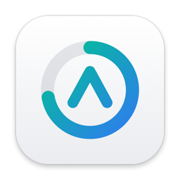
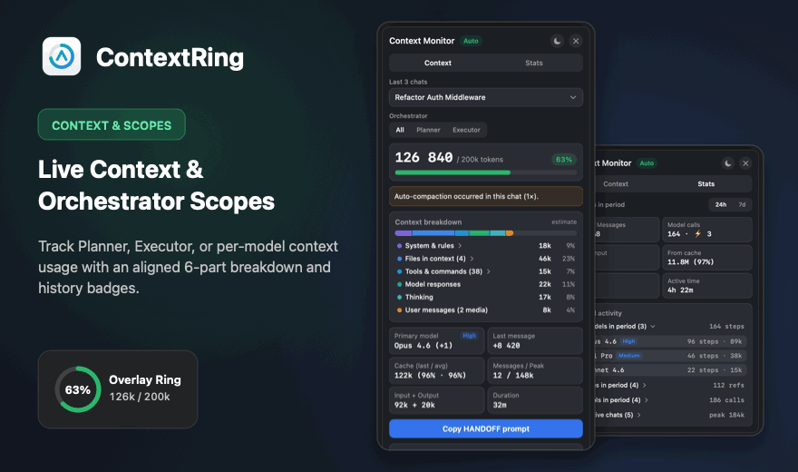
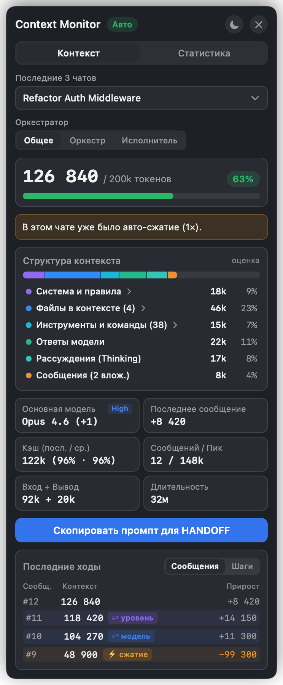
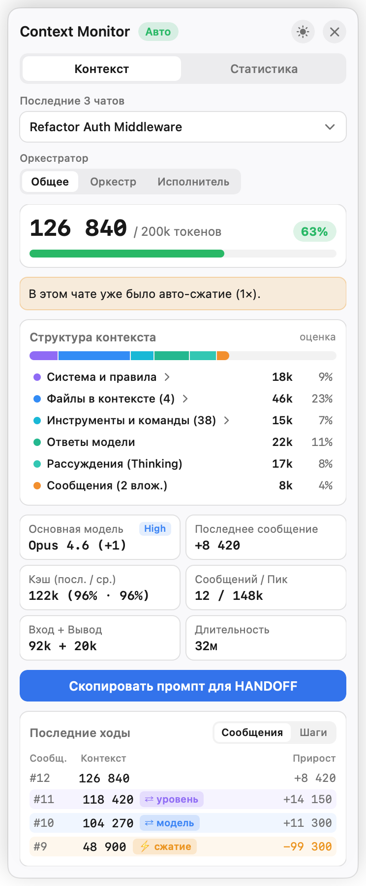
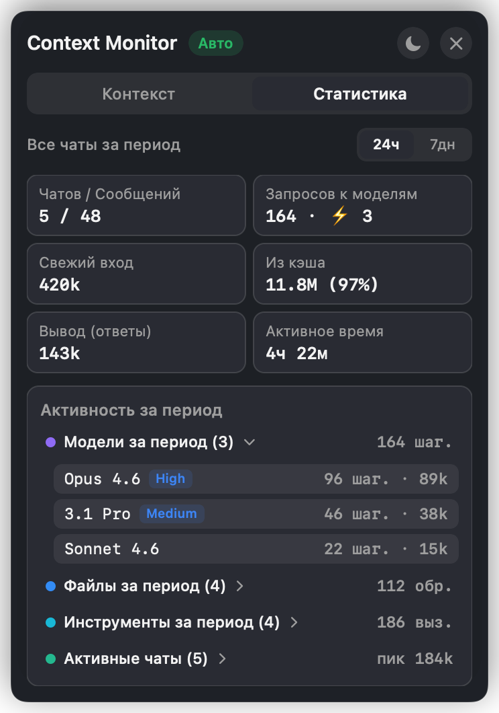
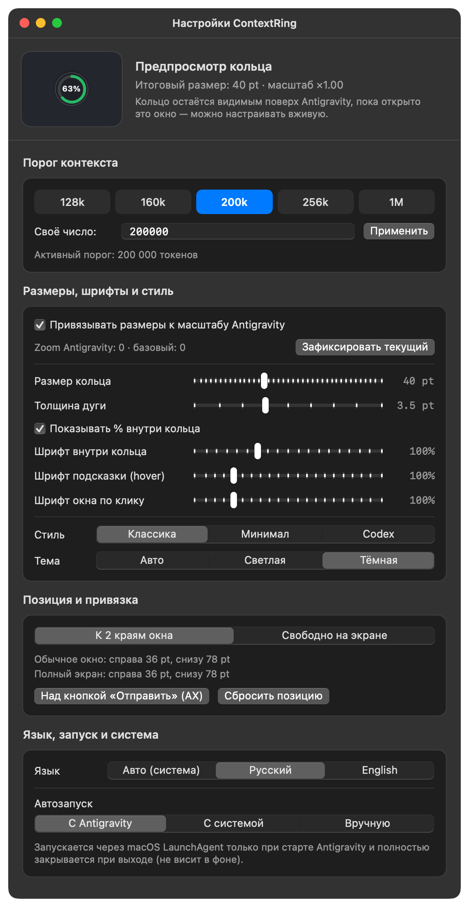
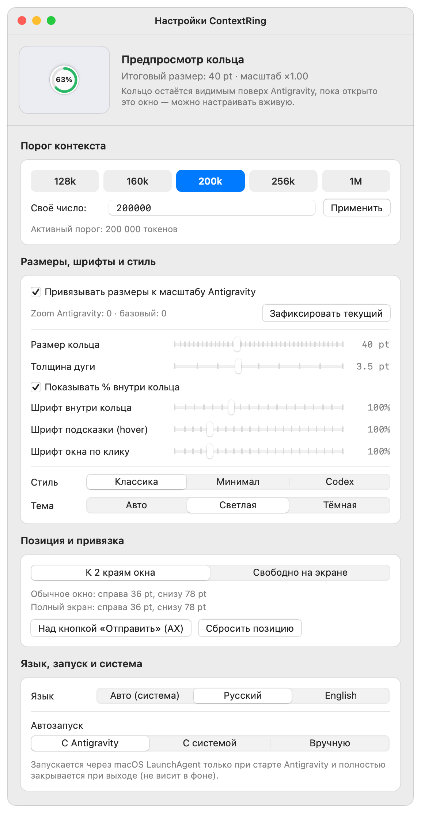

<div align="center">
  
  <h1>ContextRing для Antigravity 2.0</h1>
  <p>
    <a href="README.md">🇬🇧 English</a> &nbsp;|&nbsp; <strong>🇷🇺 Русский</strong>
  </p>
  <p>
    <a href="https://github.com/vladsboev-web/ContextRing/releases"></a>
    <a href="https://github.com/vladsboev-web/ContextRing"></a>
    <a href="LICENSE"></a>
  </p>
</div>

Нативный монитор контекста для **Google Antigravity 2.0** (`com.google.antigravity`) под macOS (Swift / AppKit / SwiftUI): плавающее кольцо поверх окна IDE и индикатор в строке меню.

> **Нужен лёгкий плагин прямо внутри IDE без оверлея?**  
> Если плавающее кольцо поверх окна не требуется или нужна кроссплатформенность (macOS / Linux / Windows) со встроенной Sidecar-панелью и мгновенными 0-токенными командами `/чат` и `/ctx`, посмотри проект **[chat_tokens](https://github.com/vladsboev-web/chat_tokens)**.

<div align="center">
  
</div>

---

## Скриншоты

### Поповер «Контекст» и «Статистика»

<table>
  <tr>
    <th align="center">Контекст (Тёмная тема)</th>
    <th align="center">Контекст (Светлая тема)</th>
    <th align="center">Статистика — 24ч / 7дн (Тёмная)</th>
  </tr>
  <tr>
    <td align="center"></td>
    <td align="center"></td>
    <td align="center"></td>
  </tr>
</table>

### Окно настроек

<table>
  <tr>
    <th align="center">Настройки (Тёмная тема)</th>
    <th align="center">Настройки (Светлая тема)</th>
  </tr>
  <tr>
    <td align="center"></td>
    <td align="center"></td>
  </tr>
</table>

---

## Что нового в 1.1.0

- **Минималистичная иконка macOS** (`Resources/AppIcon.icns`) — светлый сквиркл с градиентным кольцом контекста и логотипом Antigravity внутри.
- **Event-driven архитектура (0% нагрузки в простое)** — инкрементальное чтение хвоста `transcript.jsonl` (`FileHandle.seek`) + системные вотчеры `DispatchSourceFileSystemObject` + `AXObserver` для окон. Когда Antigravity свёрнут или закрыт, фонового опроса нет.
- **Переключатель режимов и скоупов чата** — переключение `Общее | Оркестр | Исполнитель` (в оркестраторе), `Общее | <Модели>` (при нескольких моделях в ручном режиме) или двухуровневый выбор, если в чате использовались оба режима. Обновляет кольцо, менюбар `%`, hover-подсказку и вкладку «Контекст».
- **Обновлённая таблица «Структура контекста»** — выровненная 1-колоночная таблица с раскрывающимися подкатегориями и списками файлов/инструментов (*Система и правила*, *Файлы в контексте*, *Инструменты и команды*, *Ответы модели*, *Рассуждения (Thinking)*, *Сообщения*). Пустые строки (0 токенов) скрываются.
- **Отдельная вкладка «Статистика» (`24ч / 7дн`)** — глобальная аналитика по всем чатам за период: 6 карточек сводки (*Чатов / Сообщений*, *Запросов к моделям и сжатий*, *Свежий вход*, *Из кэша*, *Вывод (ответы)*, *Активное время*) и раскрывающиеся списки (*Модели за период*, *Файлы*, *Инструменты*, *Активные чаты* с переходом по клику).
- **Уровень рассуждений (Effort) и бейджи истории** — короткие названия моделей (`Opus 4.6`, `3.1 Pro`, `4 Argon`) с пилюлей уровня (`Low` / `Medium` / `High` / `XHigh`) и точными бейджами `⚡ сжатие`, `⇄ модель`, `⇄ уровень` в истории.
- **Синхронизация темы и быстрое переключение** — автоопределение светлой/тёмной темы Antigravity (`User/settings.json` + `app_storage.json`) и кнопка смены темы (`Авто / Светлая / Тёмная`) прямо в шапке поповера.
- **Полная двуязычность (`Авто (система) / Русский / English`)** — автовыбор языка при первом запуске и мгновенное переключение в настройках и в меню статус-бара.
- **Universal Binary и обычная учётка macOS** — по умолчанию собирается сразу под `arm64` (Apple Silicon) + `x86_64` (Intel), требование `codesign` привязано к сертификату (права Accessibility не слетают при пересборке), а установка работает в том числе из-под обычной (Standard) учётной записи macOS (нативный запрос пароля админа или `--user` в `~/Applications`).

---

## Возможности

- **Плавающее кольцо поверх Antigravity**
  - Отслеживает активные окна Antigravity 2.0 на любых рабочих столах (Spaces) и в полноэкранном режиме macOS.
  - Три визуальных стиля (**Классика**, **Минимал**, **Codex**) и темы **Авто / Светлая / Тёмная**.
  - Привязка масштаба кольца, тултипа и поповера к зуму Antigravity (`zoomLevel`) + независимые слайдеры размера, толщины дуги и шрифтов.
  - Умная привязка **к 2 ближайшим краям окна** (раздельно для обычного и полноэкранного режима) или **свободное размещение на экране**.
  - Нейтральное состояние `—` для новых или пустых чатов без логов токенов.

- **Карточка при наведении и поповер по клику**
  - **Вкладка «Контекст»**: шкала заполнения и предупреждения о сжатии, «Структура контекста», сводка из 6 плиток (*Основная модель + Effort*, *Последнее сообщение/шаг*, *Кэш посл./ср.*, *Сообщений/Шагов / Пик*, *Вход + Вывод*, *Длительность*), копирование промпта для `HANDOFF.md` в 1 клик и переключатель истории `Сообщения / Шаги`.
  - **Вкладка «Статистика» (`24ч / 7дн`)**: сводка по всем чатам за сутки или неделю, модели с уровнями Effort и объёмом вывода, топ файлов, топ инструментов и переход к любому чату по клику.
  - **Переключатель последних 10 чатов** в 1 клик с автовозвратом к активному окну Antigravity при смене вкладки.

- **Режимы запуска**
  - **С Antigravity** — через нативный macOS `LaunchAgent` (`WatchPaths` на служебные файлы Antigravity): стартует только при запуске IDE и полностью закрывается при выходе (0 процессов в фоне).
  - **С системой** — нативный элемент входа (`SMAppService`): тихо висит в менюбаре и показывает кольцо при открытии Antigravity.
  - **Вручную** — без автозапуска; закрывается при выходе из Antigravity.

---

## Требования

- **macOS 13.0+** (Ventura и новее; Universal Binary поддерживает **Apple Silicon `arm64`** и **Intel `x86_64`**)
- **Google Antigravity 2.0**
- **Xcode Command Line Tools** (`swiftc`) — нужны только для сборки из исходников (`xcode-select --install`)

---

## Установка

### Через Homebrew (рекомендуется)

```bash
brew install --cask vladsboev-web/tap/contextring
```

Или сначала подключить tap отдельно:

```bash
brew tap vladsboev-web/tap
brew install --cask contextring
```

Обновление и удаление через Homebrew:

```bash
brew upgrade --cask contextring
brew uninstall --cask contextring
```

### Готовая сборка без компиляции (`.dmg` / `.zip`)

Скачай готовый `ContextRing-v1.1.1-macos-universal.dmg` или `.zip` из раздела **[GitHub Releases](https://github.com/vladsboev-web/ContextRing/releases/latest)**, перетащи `ContextRing.app` в «Программы» (`/Applications` или `~/Applications`). Если при первом запуске macOS попросит снять карантин (ad-hoc сборка без платного Developer ID), выполни:

```bash
xattr -cr /Applications/ContextRing.app
```

### Сборка и установка из исходников

```bash
git clone https://github.com/vladsboev-web/ContextRing.git
cd ContextRing

# Рекомендуется: один раз создать локальный 10-летний сертификат подписи,
# чтобы права Универсального доступа (Accessibility) сохранялись при пересборках
./setup_signing_cert.sh

# Собрать Universal Binary (arm64 + x86_64) и установить в /Applications/ContextRing.app
./install.sh
```

#### Дополнительные опции установщика

```bash
./install.sh --user        # Установить в ~/Applications/ContextRing.app (без пароля администратора)
./install.sh --skip-build  # Установить уже собранный build/ContextRing.app без пересборки
./install.sh --no-launch   # Установить без немедленного запуска
```

> **Работа под обычной (не-админ) учёткой macOS:**  
> Если у текущего пользователя нет прав на запись в `/Applications`, `./install.sh` покажет стандартное окно macOS для ввода логина и пароля администратора (или при отмене автоматически установит приложение в `~/Applications/ContextRing.app`). Либо можно сразу передать флаг `--user`.

### Права Accessibility (Универсальный доступ)

Для точного отслеживания заголовка, полноэкранного режима окна Antigravity и привязки кольца к кнопке «Отправить» выдай разрешение:

`Системные настройки → Конфиденциальность и безопасность → Универсальный доступ → ContextRing`

Статус в настройках и меню статус-бара обновляется автоматически при возврате в приложение (и каждую секунду, пока открыто окно настроек).

---

## Сборка и удаление

### Только сборка (`build/ContextRing.app`)

```bash
./build.sh            # Universal Binary (arm64 + x86_64, по умолчанию)
./build.sh --native   # Только под архитектуру текущего Mac
```

### Удаление

```bash
./uninstall.sh                 # Удаляет ContextRing.app (/Applications или ~/Applications) и LaunchAgent
./uninstall.sh --purge-prefs   # Также удаляет сохранённые настройки UserDefaults (com.vladsboev.contextring)
```

---

## Структура проекта

```text
ContextRing/
├── Sources/
│   ├── main.swift                      # Точка входа приложения
│   ├── AppDelegate.swift               # Жизненный цикл, вотчеры ФС, панели, позиционирование, менюбар
│   ├── Models.swift                    # Модели состояния, структуры контекста, скоупы и форматирование
│   ├── Localization.swift              # Локализация RU/EN и промпты для HANDOFF
│   ├── AntigravityDataReader.swift     # Event-driven чтение JSONL + SQLite WAL + настроек Antigravity
│   ├── AntigravityWindowTracker.swift  # Отслеживание окон через NSWorkspace / CGWindowList / AXObserver
│   ├── LaunchAgentManager.swift        # Менеджер нативного macOS LaunchAgent (WatchPaths)
│   ├── RingPanel.swift                 # Плавающее кольцо без рамок
│   ├── HoverTooltipPanel.swift         # Компактная подсказка при наведении
│   ├── DetailPopoverPanel.swift        # Поповер «Контекст» и «Статистика» + выбор скоупа и чата
│   └── SettingsWindow.swift            # Единое окно настроек (SwiftUI)
├── Resources/
│   ├── Info.plist                      # Метаданные бандла (v1.1.0, macOS 13+, LSUIElement)
│   └── AppIcon.icns                    # Минималистичная иконка приложения для macOS
├── assets/                             # Скриншоты интерфейса (RU/EN, тёмная и светлая темы)
├── build.sh                            # Скрипт сборки (Universal Binary / --native)
├── install.sh                          # Установщик (/Applications или --user ~/Applications)
├── uninstall.sh                        # Полное удаление (с опцией --purge-prefs)
├── setup_signing_cert.sh               # Генератор локального сертификата подписи (для TCC)
└── LICENSE                             # Лицензия MIT
```

---

## Приватность и безопасность

- **100% локально:** никаких сетевых запросов, телеметрии или внешних API-вызовов.
- **Только чтение** локальных данных Antigravity:
  - `~/.gemini/antigravity/conversation_summaries.db`
  - `~/.gemini/antigravity/brain/<conversationId>/.system_generated/logs/`
  - `~/Library/Application Support/Antigravity/app_storage.json`
  - `~/Library/Application Support/Antigravity/User/settings.json`
- Настройки приложения хранятся локально в стандартном `UserDefaults` (`com.vladsboev.contextring`).

---

## Авторы

- **vladsboev-web** — идея, архитектура и развитие продукта
- **Antigravity (Google DeepMind)** — соавтор и реализация

## Лицензия

[MIT](LICENSE)
